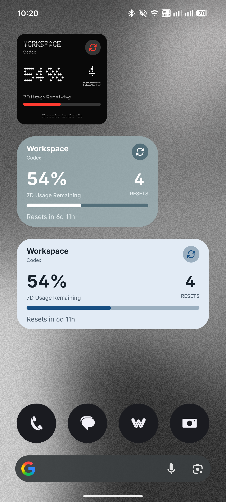

# check-usage

A self-hosted AI usage server with a terminal dashboard (`check-usage`) and an Android companion app (**AI Usage Widgets**).

Run the server on your homelab alongside your signed-in AI CLIs and provider credentials. Every paired laptop or phone reads from the same account catalog and shared usage cache over your Tailscale tailnet—without storing provider credentials on client devices. Device display settings and cached snapshots stay local.

## Supported providers

| Provider | Collection method | Server registration |
| --- | --- | --- |
| **Antigravity** (Gemini & Claude/GPT) | Native CLI only (`agy`) | `server accounts native --driver agy` |
| **Codex** (OpenAI) | Native CLI (`codex`), opt-in API fallback, or direct login | `server accounts native --driver codex` or `server accounts login --provider codex` |
| **Claude** | OAuth browser code | `server accounts login --provider claude` |
| **Cursor** | Browser login or API key | `server accounts login --provider cursor` or `server accounts add --provider cursor` |
| **OpenCode Go** | API key | `server accounts add --provider opencode-go` |
| **DeepSeek** | API key | `server accounts add --provider deepseek` |
| **Custom adapter** | Trusted admin JSON executable | `server accounts native --provider ID --source-file ...` |

## Install

Download a prebuilt binary from [GitHub Releases](https://github.com/McMelonTV/check-usage/releases), or build from source with **Go 1.26 or newer**:

```bash
go build -o check-usage .
```

The same binary runs both the homelab server and the paired terminal client. For Android, see [Android app](#android-app).

## Set up the homelab server

Run these commands as the **same OS user** who owns your signed-in AI CLI profiles. Make sure you have already signed in interactively through `agy` (using a release that supports `agy -p /usage --output-format json`) and `codex` on the host.

### 1. Initialize and register accounts

```bash
./check-usage server init
./check-usage server accounts native --driver agy --name "Google"
./check-usage server accounts native --driver codex --name "OpenAI"
./check-usage server serve
```

`server init` writes `~/.config/check-usage/server.json`, pointing to `~/.config/check-usage/accounts.json`, the shared usage cache, and a private `server-state` directory. Override the config path on any server command with `check-usage server --config /path/server.json <command>`. Keep `server-state` persistent across restarts so paired devices stay connected.

### 2. Expose over Tailscale Serve

By default, the server listens on `127.0.0.1:8787`. Bind addresses are restricted to loopback or an explicit Tailscale IP—no public listener or open internet port is needed.

On the homelab, publish the loopback listener over your tailnet with HTTPS:

```bash
tailscale serve --bg http://127.0.0.1:8787
```

Use the HTTPS URL Tailscale prints when pairing clients, and keep Tailscale connected on each device. Tailnet ACLs control network reachability while per-device bearer tokens handle application authentication.

### Keep the server running with systemd

To run the server as an optional **systemd user service**, install the binary for the same OS user after initializing your configuration:

```bash
install -Dm755 check-usage "$HOME/.local/bin/check-usage"
mkdir -p "$HOME/.config/systemd/user"
```

Save the unit below as `~/.config/systemd/user/check-usage.service`. Adjust `PATH` so it includes your installed AI CLIs (`agy`, `codex`) and their runtimes (the example includes mise shims):

```ini
[Unit]
Description=Shared AI usage server

[Service]
ExecStart=%h/.local/bin/check-usage server serve
Environment="PATH=%h/.local/bin:%h/.local/share/mise/shims:/usr/local/bin:/usr/bin:/bin"
Restart=on-failure
RestartSec=5

[Install]
WantedBy=default.target
```

Stop any foreground `server serve` process, then enable and start the unit:

```bash
systemctl --user daemon-reload
systemctl --user enable --now check-usage.service
journalctl --user -u check-usage.service -f
```

> **Note:** To start the user service at boot and keep it running after logout, enable user lingering for this account through your homelab's normal host administration.

**Operational note:** Stop the server before running local credential or source-configuration commands (`server accounts login|add|reauth|native`), then start it again. Device pairing and revocation (`server pair`, `server devices`) use separate state and can run while the server is active.

### Provider logins, API keys, and native fallbacks

All provider credentials and source configurations are managed locally on the server:

```bash
./check-usage server accounts login --provider claude --name "Claude"
./check-usage server accounts login --provider cursor --name "Cursor"
./check-usage server accounts login --provider codex --name "OpenAI API"
./check-usage server accounts add --provider opencode-go --api-key-env OPENCODE_API_KEY
./check-usage server accounts add --provider deepseek --api-key-env DEEPSEEK_API_KEY
./check-usage server accounts add --provider cursor --api-key-env CURSOR_API_KEY
./check-usage server accounts reauth <id-or-name>
```

**Opt-in API fallback for Codex:** You can attach a native Codex profile to an existing OAuth-backed server account (such as "OpenAI API" above) and explicitly enable its saved API integration as fallback:

```bash
./check-usage server accounts native --driver codex --account "OpenAI API" --fallback
```

- Fallback is **off by default** and must be explicitly enabled for an existing account with saved API credentials (`--fallback` or the source file’s `fallback` setting).
- **Antigravity is native-only.** Direct Google quota/OAuth emulation is not used; the locally installed `agy` CLI owns authentication and upstream requests.
- **Usage-only native probes:** Built-in native drivers run fixed usage-only commands (`agy -p /usage --output-format json` and Codex `app-server` read RPCs) and never send inference prompts. Probes run in private temporary working directories with timeouts, bounded output, and process cleanup; auto-updates and browser launches are disabled for `agy`. Using a native CLI does not guarantee any provider's enforcement policy, and this project makes no promises regarding account standing.
- Removing a native account unregisters it from `check-usage` without signing out the underlying CLI.

### Multiple profiles and other native adapters

To register multiple Codex profiles, point each one at its own configuration directory (passed to the CLI via `CODEX_HOME`):

```bash
./check-usage server accounts native --driver codex \
  --config-dir /srv/ai-profiles/work-codex \
  --name "Work OpenAI"
```

For administrator-supplied adapters for supported providers, use the `json` driver with `--source-file` pointing to a private JSON definition:

```json
{
  "driver": "json",
  "executable": "/srv/check-usage/adapters/provider-usage",
  "args": ["--json"],
  "env": {"PROVIDER_CONFIG_DIR": "/srv/ai-profiles/work"},
  "timeout_seconds": 30,
  "refresh_seconds": 300,
  "fallback": false
}
```

Register the adapter locally on the server:

```bash
./check-usage server accounts native \
  --provider claude \
  --source-file /private/claude-source.json \
  --name "Work Claude"
```

The executable must print a normalized JSON usage object to stdout:

```json
{
  "plan": "Pro",
  "metrics": [
    {"kind": "percentage", "slot": "session", "label": "SESSION", "used_percent": 25, "reset_at": 1795568400},
    {"kind": "percentage", "slot": "weekly", "label": "WEEKLY", "used_percent": 40, "reset_at": 1796083200}
  ]
}
```

- Valid slots are `session`, `weekly`, and `monthly`; optional `scope` identifies a model family or pool.
- Omitting `used_percent` reports the metric as unknown (`0` means measured zero usage).
- The server never accepts executable paths, arguments, environment overrides, or shell commands from remote clients.

## Pair and manage devices

Each device must be paired with its own fresh, one-use code (valid for 10 minutes) and receives an independent random bearer token. The server stores only token hashes.

### Pair a terminal client

1. Generate a pairing code on the homelab:

   ```bash
   ./check-usage server pair --name laptop
   ```

2. Connect from your laptop using the server's Tailscale HTTPS origin:

   ```bash
   ./check-usage connect --url https://homelab.your-tailnet.ts.net
   ```

Paste the code when prompted, or pass `--pair-code-file path` (`-` reads stdin). The CLI saves its token to owner-only `~/.config/check-usage/client.json` (override with `--connection-file path`).

### Pair the Android app

1. Generate a fresh code on the homelab (`./check-usage server pair --name phone`).
2. In **AI Usage Widgets**, tap **Server**, enter the HTTPS URL and pairing code, and tap **Pair device**.

The token is encrypted with Android Keystore. Accounts sync from the server automatically—pull to refresh or tap **Sync accounts** at any time. Foreground sync runs every minute, while background and widget sync follow Android's ~15-minute schedule.

### Permissions and revocation

Paired devices are **read-only by default**. To allow a device to rename or remove shared accounts on the server, issue its code with `--allow-account-changes`:

```bash
./check-usage server pair --name phone --allow-account-changes
```

Shared renames and removals propagate to other devices on their next account refresh. Credential changes and provider sign-ins always stay server-local.

List or revoke devices independently on the homelab:

```bash
./check-usage server devices list
./check-usage server devices revoke DEVICE_ID
```

- Revocation takes effect on the next request; a revoked device may still show previously cached display data locally, and reconnecting requires a new code.
- Pairing Android to a different server replaces its local account cache and widget assignments.
- **Upgrading from an older client-only version:** Previous local provider sign-ins on CLI or Android devices are not uploaded automatically—configure your accounts on the homelab server, then pair each device.

## Terminal client

```bash
./check-usage                                      # Interactive dashboard (TUI)
./check-usage --plain                              # Non-interactive usage table
./check-usage accounts list                        # List shared server accounts
./check-usage accounts rename ACCOUNT "New name"   # Rename shared account (requires write access)
./check-usage accounts remove ACCOUNT              # Remove shared account (requires write access)
./check-usage resets ACCOUNT                       # Show reset-credit details
./check-usage api usage.get '{"refresh":true}'     # Call the authenticated HTTP JSON-RPC API
```

- **Dashboard controls:** Switch between **Usage**, **Resets**, and **Settings** tabs. Press `r` to refresh, `e` to rename a shared account, `d` twice to remove it (when permitted), and `q` to quit. Display preferences stay local to each terminal client.
- **Caching & rate limits:** Clients display cached usage immediately and mark it stale when offline. Manual refreshes share the server cache and coalesce overlapping requests, enforcing minimum refresh intervals (**≥ 5 minutes** for native Antigravity and Claude; **≥ 1 minute** for other standard providers). Failed probes back off while retaining the last measured values, and slow providers do not block account discovery or other accounts. Source metadata distinguishes native reads from API fallback.
- Reset credit claiming is not implemented.

## Grouped model limits

Some subscriptions expose multiple model pools under a single account. The TUI, Android cards, and widgets render these in a shared grouped layout with clean column headers:

- **Antigravity:** Preserves all four scoped limits reported by `agy` across **Gemini** and **Claude/GPT** rows with **5-hour** and **Weekly** columns under one selectable account. Weekly-only plans do not receive invented 5-hour allowances, and missing measurements remain unknown. If a family's weekly allowance is exhausted, only that family's 5-hour allowance is struck through. In the TUI, scoped rows use a purple star indicator, muted tree connectors, and normal-text family names.
- **Cursor:** Renders **Cursor models** and **Other models** as separate independent rows, both under **Monthly** (older cached slots are normalized automatically).
- **Compact widgets:** Small square Android widgets retain all four Antigravity values; very short widgets summarize the tightest reported limit per family.

## Android app

- **Offline resilience:** Cached usage stays visible when the homelab or Tailscale is unreachable. Network errors never wipe the local account catalog.
- **Account sync:** Successful sync reconciles additions, renames, and removals while preserving widget assignments for unchanged account IDs.
- **Widget styles:** Tonal, Frosted, Midnight, Sunset, and Dot Matrix on supported Nothing devices.
- **Privacy:** No analytics or hosted backend.

### Screenshots

<p align="center">
  
  &nbsp;
  
</p>

<p align="center">
  
</p>

### Build from source

Requires **Go 1.26+**, **JDK 25**, **Android SDK 36**, and an **Android NDK** supported by Go Mobile. Minimum supported OS is **Android 8.0 (API 26)**.

```bash
cd android
./gradlew :app:testDebugUnitTest :app:assembleDebug
```

Debug APKs (one universal APK plus four per-architecture variants) are written to `android/app/build/outputs/apk/debug/`.

## Application API

Protocol **2.0** exposes versioned HTTP endpoints for paired devices (`/v1/pair`, authenticated `/v1/info`, and `/v1/rpc`) while keeping provider authentication, provider credentials, and native source configuration local to the server.

For local server administration and embedding, the importable `usageapi` Go package and local NDJSON interface (`check-usage server api serve`) remain available.

See [docs/application-api.md](docs/application-api.md) for the transport specification, pairing flow, metric schema, and local administration API.
